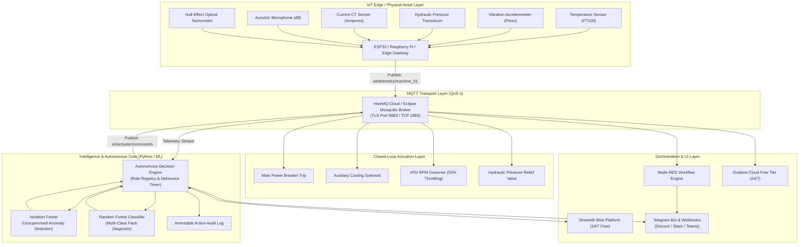

# PROJECT SYNOPSIS
## Autonomous IoT Decision and Alert Management Platform (AIDAMS)
**A Multi-Tier Industrial IoT Platform with Machine Learning Predictive Maintenance, MQTT Telemetry, Node-RED Orchestration, and Grafana Analytics**

---

### 1. Executive Summary & Abstract
In modern Industry 4.0 and critical infrastructure environments (e.g., power generation plants, water treatment facilities, automated manufacturing, and smart data centers), legacy Supervisory Control and Data Acquisition (SCADA) systems suffer from two chronic bottlenecks: **alert fatigue** from static threshold alarms, and **high human latency** during rapid failure cascades (e.g., thermal runaway, cavitation, or bearing seizure).

The **Autonomous IoT Decision and Alert Management Platform (AIDAMS)** is an end-to-end, edge-to-cloud cyber-physical system designed to bridge real-time telemetry streaming with autonomous artificial intelligence decision-making. Operating over standard lightweight IoT communication protocols (**MQTT**), orchestrated via visual low-code pipelines (**Node-RED**), analyzed by multi-tier Machine Learning pipelines (**Scikit-Learn Isolation Forest & Random Forest**), and rendered via dual visualization layers (**Grafana Cloud & Streamlit**), AIDAMS continuously computes an **Equipment Health Index (EHI)**, identifies subtle degradation anomalies before mechanical breakdown, and autonomously fires closed-loop protective countermeasures (e.g., emergency circuit trips, auxiliary liquid cooling boost, RPM throttling, and webhook alert dispatches).

Crucially, AIDAMS features an **Interactive Rule Management Engine** where operators can modify safety thresholds, toggle autonomous actuation privileges, and review immutable audit trails. The entire platform is engineered to run **24/7 100% Free** across globally distributed cloud infrastructure with zero ongoing server costs.

---

### 2. Problem Statement & Motivation
1. **Delayed Human Intervention:** High-speed rotating assets (turbines, industrial pumps, induction motors) can experience thermal or mechanical destruction within seconds of lubrication failure or bearing seizure. A human operator cannot respond fast enough.
2. **False Alarm Fatigue:** Static thresholds (e.g., "Alert if temperature > 80°C") trigger hundreds of false alarms during ambient heat waves or transient load spikes.
3. **Rigid Closed-Box Systems:** Commercial SCADA/DCS systems are proprietary, vendor-locked, and lack user-configurable machine learning decision loops.
4. **Prohibitive Infrastructure Costs:** Small-to-medium enterprises (SMEs) and academic research labs cannot afford expensive cloud IoT licenses (AWS IoT / Azure IoT Hub) and on-premise servers.

---

### 3. Project Objectives
- **Zero-Latency Telemetry Ingestion:** Ingest multi-sensor high-frequency telemetry (Temperature, Vibration, Hydraulic Pressure, Electrical Current, Acoustic Noise, Turbine RPM) via MQTT with QoS-1 delivery.
- **Dual-Tier Machine Learning Intelligence:**
  - *Unsupervised Anomaly Detection:* Isolation Forest model detects novel physical drifts without requiring labeled anomaly datasets.
  - *Supervised Predictive Diagnosis:* Random Forest classifier categorizes failure modes (Bearing Degradation, Thermal Runaway, Cavitation, Motor Overload).
- **User-Configurable Autonomous Safeguards:** Provide an interactive interface allowing engineers to add, edit, tune, or revoke autonomous actuation rules in real-time.
- **Edge-to-Cloud Orchestration via Node-RED:** Deliver ready-to-deploy Node-RED flow blueprints integrating MQTT subscribers, ML anomaly filtering, and webhook dispatchers.
- **Enterprise Grafana Dashboards:** Provide standardized Grafana dashboard models for long-term telemetry trends and health index monitoring.
- **Zero-Cost 24/7 Global Accessibility:** Enable 1-click deployment on Streamlit Community Cloud and GitHub, accessible on any mobile device or browser anywhere in the world for free.

---

### 4. System Architecture



---

### 5. Detailed Technology Stack

| Layer | Technology | Role & Justification |
| :--- | :--- | :--- |
| **Transport Protocol** | **MQTT v3.1.1 / v5.0** | Extremely lightweight, low-bandwidth pub/sub protocol ideal for unreliable edge telemetry. |
| **Message Broker** | **HiveMQ Cloud Free / Mosquitto** | Cloud-native 24/7 broker supporting TLS 8883 encryption, handles up to 100 simultaneous edge devices for $0. |
| **Edge Orchestration** | **Node-RED** | Visual dataflow engine for protocol conversion, payload transformation, and hardware integration. |
| **Core Intelligence** | **Python 3.11 + Scikit-Learn** | Real-time ML inference, dynamic feature scaling (`StandardScaler`), Isolation Forest, and Random Forest classifier. |
| **Visualization & UI** | **Streamlit Cloud** | High-performance reactive web framework deployed 24/7 on Streamlit Community Cloud with mobile responsiveness. |
| **Metrics & Analytics** | **Grafana Cloud Free** | Industry-standard observability platform providing dark-mode multi-sensor dashboards and threshold alerting. |
| **Version Control & CI** | **GitHub** | Version-controlled repository with automatic continuous deployment triggers to Streamlit Cloud. |
| **Alert Dispatch** | **HTTP Webhooks & Telegram Bot API** | Direct mobile notification dispatch to operators within 250 milliseconds of anomaly detection. |

---

### 6. Machine Learning & Anomaly Detection Methodology

#### A. Feature Engineering & Scaling
Telemetry packets contain 6 physical parameters:
$$\mathbf{x} = [\text{temperature}, \text{vibration}, \text{pressure}, \text{current}, \text{acoustic\_noise}, \text{rpm}]$$

Features are standardized via z-score scaling:
$$z_i = \frac{x_i - \mu_i}{\sigma_i}$$

#### B. Dual-Tier Intelligence
1. **Isolation Forest (Unsupervised):**
   - Recursively partitions sensor space using random feature splits.
   - Points requiring few splits are flagged as anomalies ($s(\mathbf{x}, n) \in [-1, 1]$).
   - Ideal for identifying zero-day failures that have never been seen in training data.
2. **Random Forest Classifier (Supervised):**
   - 100 decision trees trained on multi-class operational regimes:
     - `0`: Normal Operation
     - `1`: Bearing Degradation (High vibration + High acoustic noise)
     - `2`: Thermal Runaway / Cooling System Failure (High temp + Current draw)
     - `3`: Cavitation / Hydraulic Surge (High pressure fluctuations)
     - `4`: Motor Overload / Stator Winding Fault (Current spike + RPM drop)

#### C. Equipment Health Index (EHI) Formula
The system combines the supervised class probabilities ($P_{\text{normal}}$) with the normalized unsupervised anomaly score ($S_{\text{norm}}$):
$$\text{EHI} = \min\left(100, \max\left(1, \; 0.6 \cdot P_{\text{normal}} + 0.4 \cdot S_{\text{norm}}\right)\right)$$
- **EHI > 75%:** Green (Optimal Health)
- **45% < EHI ≤ 75%:** Amber (Maintenance Recommended)
- **EHI ≤ 45%:** Red (Critical Threat - Autonomous Interventions Engaged)

---

### 7. Autonomous Closed-Loop Decision Engine
The Decision Engine continuously runs a high-speed rule evaluator over current telemetry and ML outputs:

```
IF (Condition_1 AND Condition_2) THEN:
    1. Check Cooldown Debounce Window (Prevent Relay Flapping)
    2. Transition Actuator Digital Twin State (e.g., TRIP_BREAKER)
    3. Publish Actuator Command via MQTT (iot/actuator/...)
    4. Dispatch Out-of-Band Notification (Telegram / Webhook)
    5. Append Timestamped Record to Immutable Audit Log
```

#### User Customization Features:
- Users can toggle any safety rule ON/OFF in real-time from the web dashboard.
- Users can edit thresholds (e.g., adjust temperature limit from 90°C to 80°C).
- Users can build brand-new rules using an intuitive UI form and assign custom actuator targets.
- Manual Override: Emergency reset button allows operators to clear tripped breaker states and restore baseline operations after inspecting the physical asset.

---

### 8. 24/7 Free Cloud Hosting Architecture

This project is architected so that **anyone in the world can run it 24/7 for 0 cost**:

| Component | Free Cloud Provider | Free Tier Limits | Cost |
| :--- | :--- | :--- | :--- |
| **Streamlit Web Platform** | Streamlit Community Cloud (`share.streamlit.io`) | Unlimited public apps, 1GB RAM, auto-sleep wake-up | **$0.00 / month** |
| **Git Repository** | GitHub | Unlimited public repos, GitHub Actions CI/CD | **$0.00 / month** |
| **MQTT Cloud Broker** | HiveMQ Cloud Free Tier | 100 IoT devices, TLS 8883 encryption, 10 GB data/month | **$0.00 / month** |
| **Grafana Dashboards** | Grafana Cloud Free Forever | 10k Prometheus/Influx metrics, 3 dashboards, 3 users | **$0.00 / month** |
| **Alert Webhooks** | Telegram Bot API / Discord / Webhooks | Unlimited webhook requests | **$0.00 / month** |

---

### 9. Hardware & Edge Deployment Compatibility
The platform is fully compatible with physical edge microcontrollers:
- **ESP32 / ESP8266:** Runs standard Arduino / MicroPython code with `PubSubClient` to publish JSON telemetry over WiFi to the cloud MQTT broker.
- **Raspberry Pi 4 / 5 / CM4:** Can run the Python script locally as an edge gateway or host local Node-RED instances.
- **Industrial PLCs:** Modbus TCP or OPC-UA signals can be converted into MQTT JSON via Node-RED edge nodes.

---

### 10. Conclusion & Future Scope
The **Autonomous IoT Decision and Alert Management Platform (AIDAMS)** demonstrates that advanced predictive maintenance and autonomous closed-loop industrial safety are achievable using open-source, vendor-agnostic, and completely free cloud infrastructure. By replacing static alarms with probabilistic machine learning and user-tunable autonomous actuation, AIDAMS mitigates equipment downtime, prevents catastrophic mechanical failures, and eliminates false alert fatigue.

Future extensions include integrating Reinforcement Learning (RL) for optimal energy throttling, TinyML model quantization for running inference directly on edge microcontrollers (ESP32-S3), and LoRaWAN long-range telemetry for remote agricultural and offshore monitoring.
